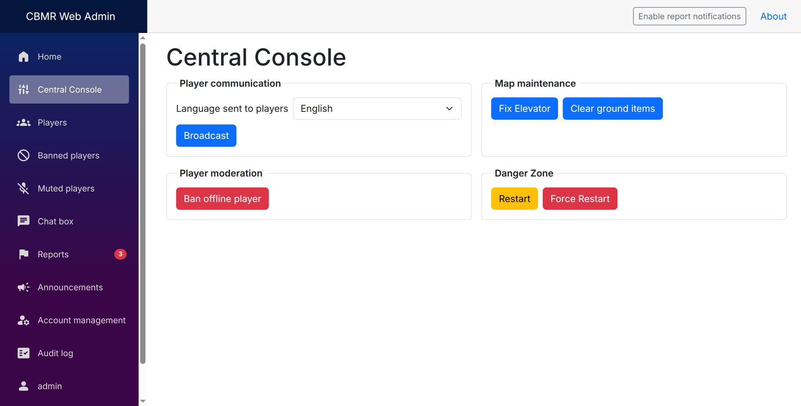
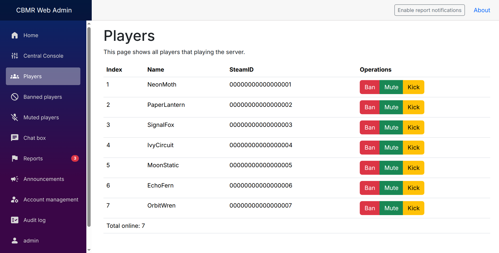
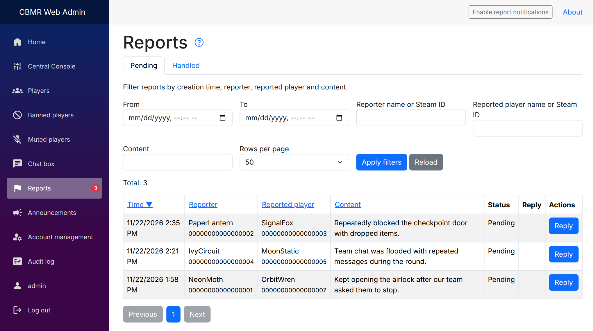
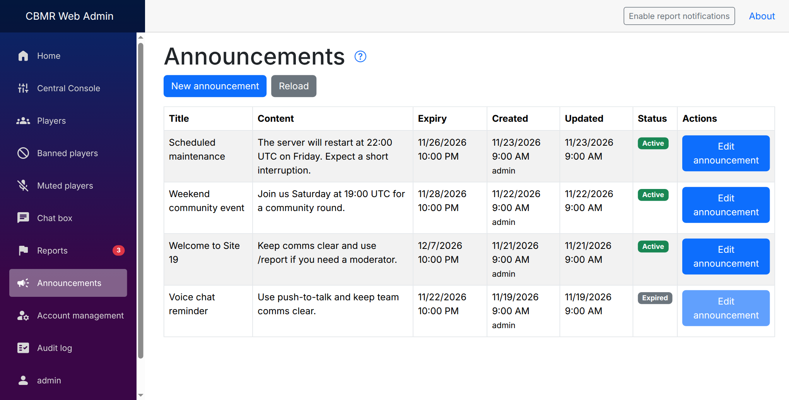

<div align="center">

# CBMR Web Admin

A website that manages a CBMR server without launching the game, powered by *[CB2 CSharp Binding](https://github.com/EasyT-T/ccb)*.


<!--  -->


</div>

## Highlights

- **Manage the server from a browser.** Broadcast to players, fix the elevator, clear dropped items, and restart the server without launching the game.
- **Moderate players in one place.** See who's online, follow live chat, kick or ban players, and mute text or voice chat separately.
- **Follow up on in-game reports.** Players submit reports with `/report`. Admins can filter the queue and reply from the portal; offline players receive replies when they return.
- **Reach players as they join.** Publish announcements with an expiry date. Players see unread, unexpired announcements as in-game pop-ups on join.
- **Share admin access without sharing an account.** The primary admin manages individual accounts. The audit log shows who performed admin actions, and the session log tracks player joins and departures.

## Screenshots

These screenshots show the actual web portal with fictional players, Steam IDs, reports, and announcements.

**Central Console** — Broadcast, maintain the map, and restart the server.



<details>
<summary>See the Players, Reports, and Announcements pages</summary>

**Players** — See who's online and take action from the player list.



**Reports** — Filter incoming reports, track their status, and reply.



**Announcements** — Create and edit in-game notices and check their expiry.



</details>

## Overview

CBMR Web Admin has two parts that talk to each other over a local named pipe (`CbmrWebAdmin`), so both must run on the same machine:

- **WebPortal**: an ASP.NET Core Blazor site that serves the admin interface and stores admin accounts and audit events in SQLite.
- **ServerBinding**: a [CCB](https://github.com/EasyT-T/ccb) plugin that applies admin actions in game and runs player-facing features like `/report`. It stores game-side records in a separate SQLite database.

Always deploy the portal and the binding from the same version; a newer portal may send requests an older binding does not understand.
Run WebPortal and the game server under the same OS account: only the account running ServerBinding can connect to its command and events pipes.

## Installation

### Prerequisites

- A CBMR server with [CCB](https://github.com/EasyT-T/ccb/releases) installed (follow its *Installing CCB* steps).
- [.NET 10](https://dotnet.microsoft.com/download/dotnet/10.0): the SDK to build, plus the x86 runtime for CCB and the ASP.NET Core runtime for the portal.

### 1. Build

```shell
git clone https://github.com/ZiYueCommentary/CBMR-Web-Admin.git
cd CBMR-Web-Admin
dotnet publish ServerBinding/ServerBinding.csproj -c Release -r win-x86 --no-self-contained -o publish/binding
dotnet publish WebPortal/WebPortal.csproj -c Release -o publish/portal
```

### 2. Install the binding

1. Copy `publish/binding/CbmrWebAdmin.ServerBinding.dll` into `path/to/server/ccb/plugins`. Both languages (English and Simplified Chinese) are embedded in this dll.
2. Copy the other `.dll` files from `publish/binding` (`CbmrWebAdmin.Shared.dll`, MessagePack, Entity Framework Core, SQLite and `Microsoft.Extensions.*`, including the native `e_sqlite3.dll`) into `path/to/server/ccb/dependencies`. Skip `CCB.dll`, which CCB already provides.
3. Start the server. The plugin creates its config `webadmin.json` on first load; `DatabasePath` (default `Data/webportal.db`) sets where its database is stored.

### 3. Install the portal

1. Copy the full `publish/portal` folder (or extract the `WebPortal` artifact from the Build workflow for the same version) to a folder on the same machine as the game server. If deploying from `dotnet build` instead, rebuild with the current source and copy the entire output folder, including `wwwroot`.
2. Edit `appsettings.json` there and add the database and listening address (change the port as you like):

   ```json
   {
     "ConnectionStrings": {
       "DefaultConnection": "DataSource=Data/webadmin.db;Cache=Shared"
     },
     "Kestrel": {
       "Endpoints": {
         "Http": { "Url": "http://*:5000" }
       }
     },
     "PipeReconnectDelaySeconds": 5
   }
   ```

   Keep the existing `Logging` and `AllowedHosts` entries. Create the `Data` folder if it does not exist.
3. Run `CbmrWebAdmin.WebPortal.exe` (or `dotnet CbmrWebAdmin.WebPortal.dll`) from that folder.
4. On first start the portal creates the primary admin account (`admin` by default). Set `InitialAdmin__Password` (or `InitialAdmin:Password` in configuration, and optionally `InitialAdmin__UserName`) to inject the password at deployment; otherwise a random password is written to `Data/initial-admin-credentials.txt` (or `InitialAdmin:CredentialsFilePath`) instead of the log. Sign in at `http://<host>:5000`, delete the credentials file if generated, and add other accounts from the *Accounts* page.

The portal reconnects to the binding automatically; until the game server is running it shows a "No connection with server" banner.

### Updating

Stop the portal and the server, replace the files of both with published output from the same version, then start them again. Your `appsettings.json`, `webadmin.json` and both databases are kept.
